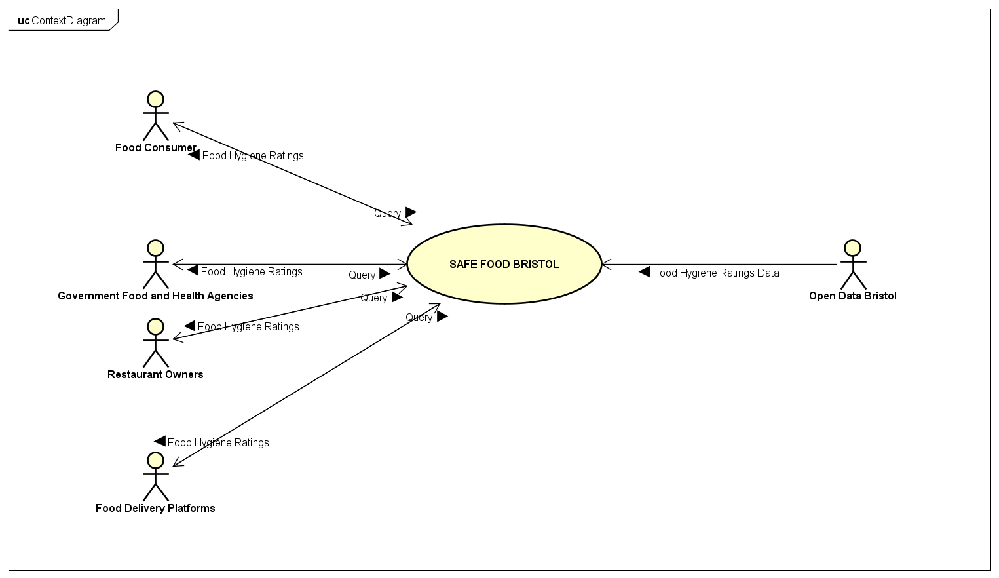

# Project Proposal

## Business Case

### Problem statement
Food safety in the food market is one of the key areas of focus in public health, because it affects people of every age, race, gender, and income level around the world. Failure of restaurants to ensure food safety in their respective domains leads to the contraction of foodborne illnesses by their unsuspecting customers. Foodborne illnesses are usually infectious or toxic in nature and caused by bacteria, viruses, parasites or chemical substances entering the body through contaminated food. Chemical contamination can lead to acute poisoning or long-term diseases, such as cancer. Many foodborne diseases may lead to long-lasting disability and death.

### Business benefits
The Safe Food Bristol application provides users with up-to-date information regarding the health standards of various restaurants around Bristol. This ensures that one can know whether the restaurant they desire to dine at or order from is compliant with the required food safety standards thus curbing the contraction of foodborne illnesses. The application uses data from Bristol Open Data to display information about food establishments concerning their hygiene inspection results. Users can search for restaurants, explore available ratings, and compare different establishments before deciding where to purchase food. By presenting this information in a clear and user-friendly format, Safe Food Bristol makes it easier for people to identify restaurants with high hygiene standards and avoid those with potentially concerning ratings. The application furthermore promotes public awareness of food safety, encourages restaurant owners to maintain good hygiene practices and ensures greater transparency within Bristol's food industry.

### Options Considered
#### Weighted Pugh Matrix
|  | **Weight** | **Static Website** | **Interactive Website** |
| --------- | ---------- | ----------- | ----------- |
| Data Update Functionality | 2 | S | ++ |
| Maintenance | 1 | S | - |
| Development Complexity | 2 | S | - |
| User Engagement | 1 | S | + |
| Total |  | 0 | 2 |

When developing the Safe Food Bristol application, two possible approaches were considered: a static website and an interactive website. Both options would allow users to access information about the hygiene standards of restaurants around Bristol. 
A static website would present information to users through fixed web pages. One of its main advantages is its simplicity, as it would be relatively easy to develop and maintain. Since the information would not require complex functionality to display, the development process would be less demanding. However, a major disadvantage is that updating restaurant hygiene information would require manual changes to the website. This could make it difficult to ensure that users consistently access the most recent information. Furthermore, the limited opportunities for user interaction could reduce engagement and make it harder for users to find specific restaurants or filter results according to their preferences. 
On the other hand, an interactive website would provide users with additional functionality, allowing them to engage with the information presented. For example, users could search for specific restaurants, filter results according to hygiene ratings and potentially sort restaurants based on their performance. It could also incorporate functionality that retrieves and displays updated information from Bristol Open Data, reducing the need for frequent manual updates. This would make the application more useful and convenient, as users could easily find relevant information when deciding where to eat. Additionally, interactive features would improve user engagement by giving visitors greater control over how they access and explore the data. Despite these advantages, an interactive website would be more complex to develop and maintain. Implementing features such as search functionality, filtering and data retrieval would require additional programming knowledge and development time. It may also require more frequent testing and troubleshooting to ensure that all interactive features operate correctly. Therefore, although an interactive website offers greater functionality, it would demand more development resources than a static website. 
To determine the most suitable option, the two alternatives were evaluated using a weighted Pugh matrix. Data update functionality and development complexity were assigned the highest weights of 2 because they are particularly important to the application's purpose and successful implementation. Maintenance and user engagement were assigned weights of 1. The static website was used as the baseline. Overall, the weighted Pugh matrix produced a score of 2 for the interactive website, compared to 0 for the static website. This indicates that, despite the additional complexity and maintenance requirements, the advantages of an interactive website outweigh its disadvantages. Therefore, an interactive website was selected as the preferred option for developing Safe Food Bristol because it would provide a more engaging and functional platform, making it easier for users to access, explore and make informed decisions using restaurant hygiene information.

### Expected Risks
The Safe Food Bristol application is likely to face challenges of inaccurate or incomplete data regarding hygiene ratings from Open Data Bristol which might mislead users. Additionally, data provided by Open Data Bristol might not be up to date also leading to misinformation. Other issues include unexpected changes to the format of data on Open Data Bristol that could affect the API and crush the website, security breaches from hackers opting to change ratings to boost their own restaurants, legal repercussions arising from ill representation of restaurants, failure to meet all user needs leading to bad feedback and low website traffic leading to the eventual shutdown of the website. 
To mitigate these risks, the following will be undertaken. Validating information from Open Data Bristol using the Food Standards Agency, checking on whether data is updated regularly manually, monitoring the data source to be informed on an changes in format, applying HTTPS to boost website security, linking authoritative sources like the Government of UK to showcase authenticity of the data, testing with various users before deploying the app and setting up a social media page to ensure promotion of the application.  

## Project Scope

