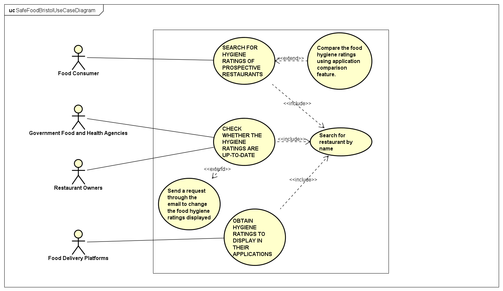

# Requirements

## User Needs

### User stories
As a food consumer, I want to be able to search for food hygiene ratings of restaurants I desire to eat from so that I can avoid contracting illness arising from food poisoning.

As an owner of a food delivery platform, I want to be able to incorporate food hygiene ratings of the restaurants I offer services to in order to help give food consumers more information regarding restaurants they opt to dine from as well as avoid delivering contaminated food for which I could be held liable. 

### Actors
- Food Consumers
- Government Food and Health Agencies
- Food Delivery Platforms
- Restaurant Owners

### Use Cases

| UC1 | SEARCH FOR HYGIENE RATINGS OF PROSPECTIVE RESTAURANTS | 
| -------------------------------------- | ------------------- |
| **Description** | Allows one to look up food hygiene ratings of restaurants within Bristol. |
| **Actors** | Food Consumers |
| **Assumptions** | User knows the specific restaurant they are making an enquiry on. |
| **Steps** | <ul><li>Search for restaurant by name</li><li>View food hygiene ratings and inspection date</li><li>Use information to discern suitability of restaurant for dining requirements</ul> |
| **Variations** | Compare the hygiene ratings of two or more different restaurants using application comparison feature. |
| **Non-functional** | Servers hosting the application should be constantly online. |
| **Issues** | Outdated ratings on the Food Hygiene Ratings Dataset on Open Data Bristol. |

| UC2 | CHECK WHETHER THE HYGIENE RATINGS ARE UP-TO-DATE | 
| -------------------------------------- | ------------------- |
| **Description** | Enables one to check and confirm whether the food hygiene ratings posted on the application are valid. |
| **Actors** | Government Food and Health Agencies, Restaurant Owners |
| **Assumptions** | User has access to records having up-to-date hygiene ratings of their specific restaurant. |
| **Steps** | <ul><li>Search for a restaurant by name. </li><li>View its respective food hygiene rating.</li><li> Compare the rating with the one saved in relevant records.</li></ul> |
| **Variations** | Send a request through the email linked on the website to have a falsely displayed food rating changed. |

| UC3 | OBTAIN HYGIENE RATINGS TO DISPLAY IN THEIR APPLICATIONS  | 
| -------------------------------------- | ------------------- |
| **Description** |  Allows one to look up food hygiene ratings of restaurants within Bristol and use that information for display in their respective applications. |
| **Actors** | Food Delivery Platforms |
| **Steps** | <ul><li>Search for restaurants they offer delivery services to.</li><li>View the respective food hygiene ratings.</li><li>Use information gained to display food hygiene ratings in their applications.</li></ul> |

## Software Requirements Specification
### Functional requirements
TODO: create a list of functional requirements. 
    e.g. "The system shall ..."
    Give each functional requirement a unique ID. e.g. FR1, FR2, ...
    Indicate which UC the requirement comes from.

### Non-Functional Requirements
TODO: Consider one or more [quality attributes](https://en.wikipedia.org/wiki/ISO/IEC_9126) to suggest a small number of non-functional requirements.
Give each non-functional requirement a unique ID. e.g. NFR1, NFR2, ...

Indicate which UC the requirement comes from.
